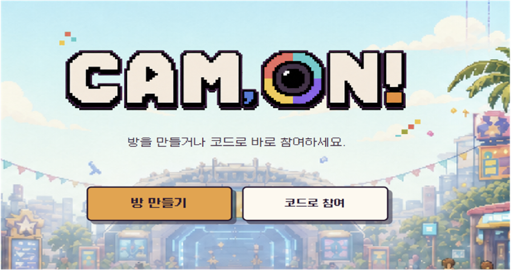
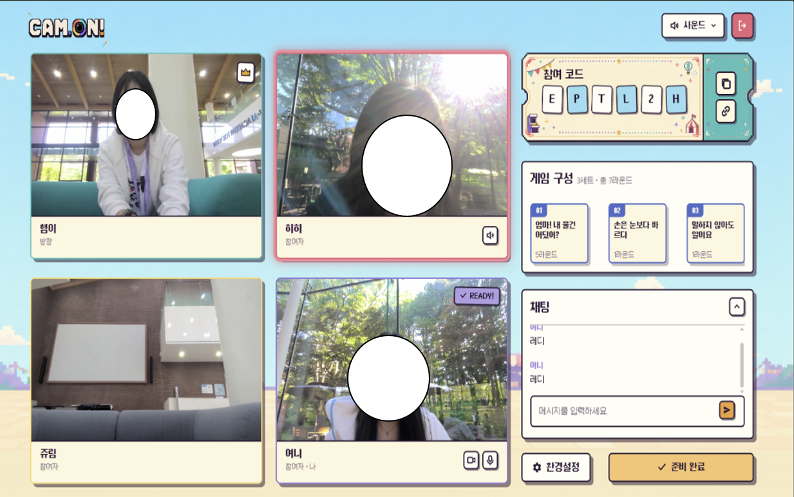
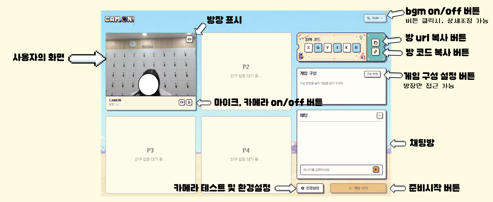
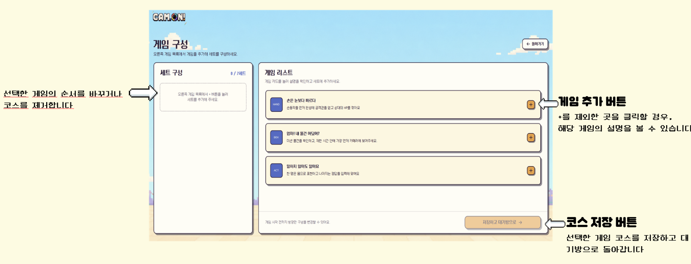
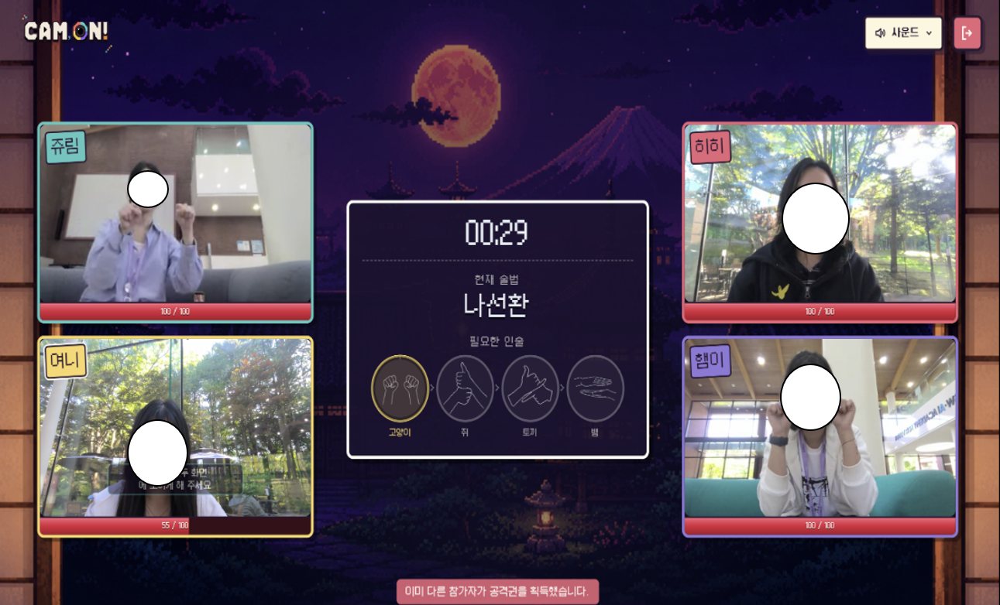
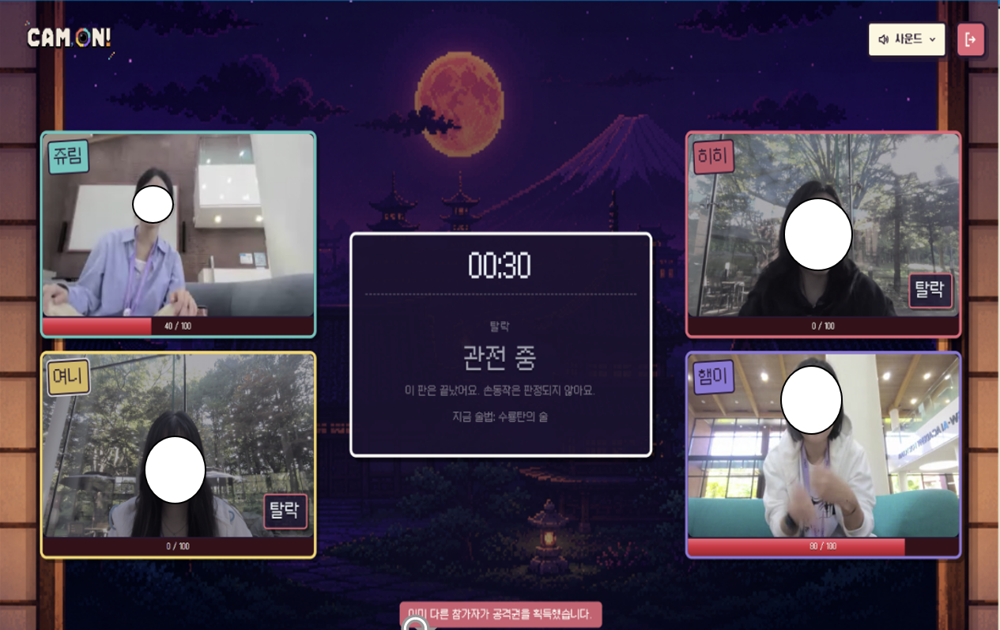
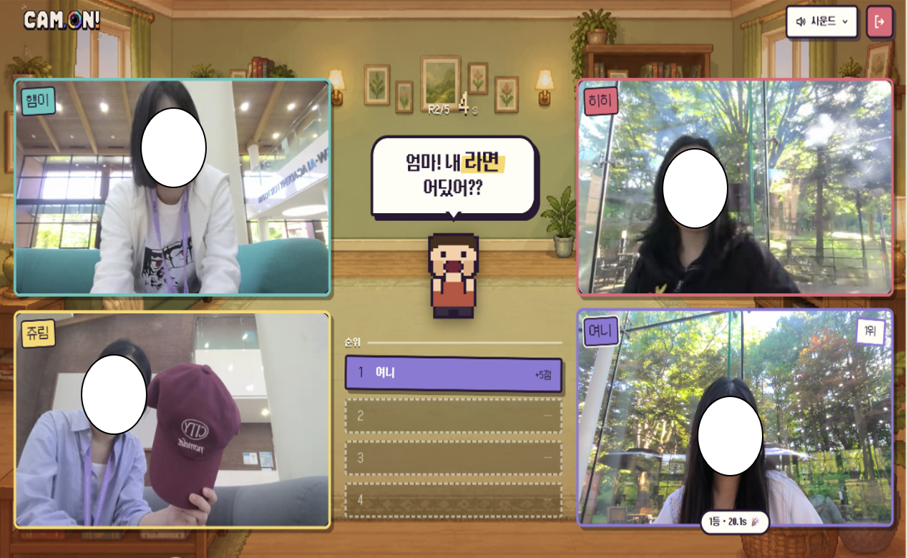
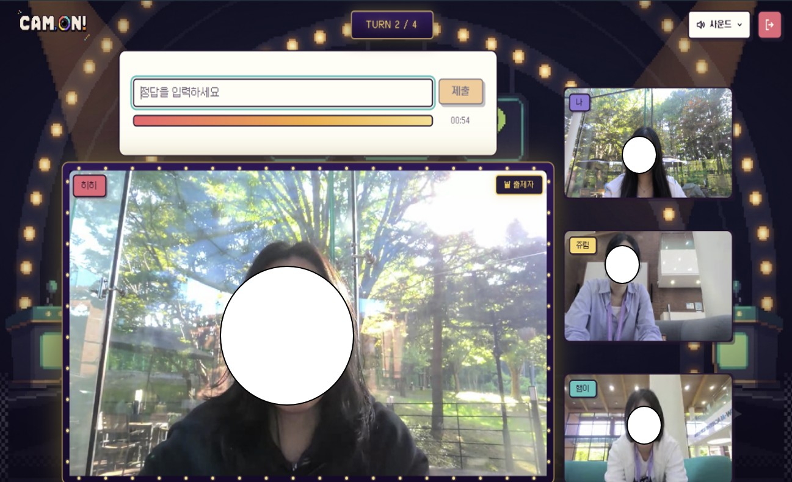
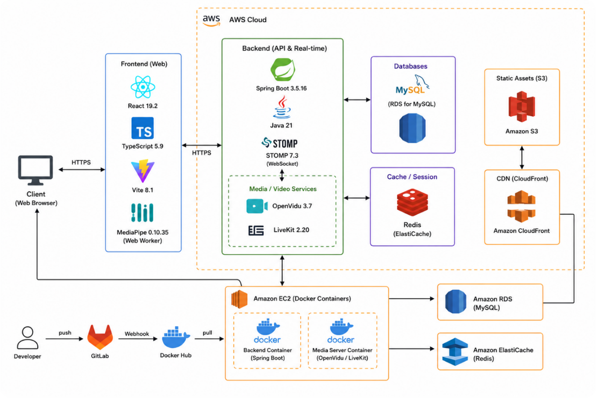
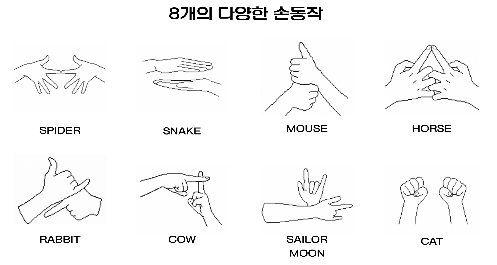

# Cam-ON

> 카메라를 켜고, 몸으로 노는 화상 파티게임

Cam-ON은 WebRTC 화상통화와 MediaPipe 손동작 인식을 결합한 실시간 미니게임 플랫폼입니다.
회원가입 없이 방 코드나 링크로 들어와 2~4명이 함께 플레이하며, 키보드 대신 손동작과 몸짓으로 게임을 진행합니다.

- SSAFY 15기 공통 프로젝트 (WebRTC 트랙), 6인 팀
- 기간: 2026.07 ~ 2026.08

<!-- 메인 화면 / 대기방 사진 -->

## 게임 소개

대기방에서 방장이 게임 순서를 코스로 짜면(최대 7세트), 코스 순서대로 게임이 이어지고 마지막에 종합 순위가 나옵니다.

### 닌자 「손은 눈보다 빠르다」

<!-- 닌자 게임 사진 -->

화면에 제시된 손동작 콤보를 가장 먼저 완성한 사람이 공격권을 얻는 손동작 배틀 게임입니다.

- 공격권을 얻으면 공격할 상대를 지정하고, 콤보에 해당하는 스킬로 상대 HP를 깎습니다.
- 스킬은 나선환, 아마테라스, 냥냥펀치, 벚꽃 참격 등 10종이며, 스킬마다 전용 이펙트가 재생됩니다.
- 마지막 1명이 남을 때까지 진행하고, 늦게 탈락한 순서대로 순위가 매겨집니다.
- 인원: 2~4명

### 물건 가져오기 「엄마! 내 물건 어딨어?」

<!-- 물건 가져오기 사진 -->

제시된 물건을 제한 시간 안에 찾아 카메라 앞에 가져오는 게임입니다. AI 서버가 화면 속 물체를 인식해 판정하고, 빨리 가져온 순서대로 순위가 매겨집니다.

- 인원: 2~4명, 1세트 5라운드

### 몸으로 말해요 「말하지 않아도 알아요」

<!-- 몸으로 말해요 사진 -->

표현자가 마이크 없이 몸짓으로 제시어를 설명하고, 나머지 참가자가 채팅으로 정답을 맞히는 게임입니다. 정답이 나오면 표현자와 첫 정답자가 각각 1점을 얻습니다.

- 인원: 3~4명, 참가자 전원이 한 번씩 표현

## 기술 스택

| 구분 | 기술 |
| --- | --- |
| Frontend | React 19, TypeScript, Vite, LiveKit(WebRTC), STOMP, MediaPipe Tasks Vision, Pixi.js |
| Backend | Java 21, Spring Boot 3.5, WebSocket(STOMP), Redis, MySQL |
| AI | Python, FastAPI, SigLIP 2 (물건 인식, zero-shot 분류) |
| 손동작 인식 | MediaPipe Hands, MLP 키포인트 분류기 (TensorFlow로 학습 후 브라우저로 이식) |
| Infra | AWS EC2, Docker Compose, Jenkins, Caddy(HTTPS) |
| 테스트, 분석 | JUnit, JaCoCo, k6, Metabase |

## 아키텍처

- 상태 변경 요청은 REST, 변경 전파는 STOMP 이벤트로 나눴습니다.
- 방과 게임 진행 상태는 Redis에 두고 방이 끝나면 모두 삭제합니다. MySQL에는 게임 종류, 제시어, 스킬 조합처럼 거의 바뀌지 않는 데이터만 둡니다.
- 손동작 인식은 서버를 거치지 않고 브라우저에서 끝냅니다. 4명이 초당 수십 번 인식하는 구조라 서버 왕복을 두면 지연과 부하가 함께 커지기 때문입니다. 그래서 AI 서버가 꺼져 있어도 닌자 게임은 그대로 동작합니다.

## 개인 기여 (양해미)

**개요**

닌자 게임과 손동작 인식을 중심으로 개발했고, develop 병합 관리와 배포를 맡았습니다.

### 손동작 인식

<!-- 손동작 인식 화면 사진 -->

- **양손 조합 손동작 9종 정의 및 학습**: 오픈소스 손동작 인식 모델([Kazuhito00/hand-gesture-recognition-using-mediapipe](https://github.com/Kazuhito00/hand-gesture-recognition-using-mediapipe))을 가져와, 한 손 동작만 구분하던 분류기를 양손 조합(horse, cow, rabbit, snake, mouse, cat, spider, sailor_moon, beam)으로 확장하고 데이터를 모아 다시 학습했습니다.
- **Python 모델을 브라우저로 이식**: Python GUI 환경에서 돌던 분류기의 가중치를 JSON으로 내보내고, 전처리와 MLP 추론을 TypeScript로 다시 구현해 서버 왕복 없이 브라우저에서 인식이 끝나도록 만들었습니다.
- **인식 흔들림 보정**: 랜드마크 좌표에 One Euro 필터를 적용해 떨림을 줄이고, 연속 5프레임 다수결로 판정해 한 프레임의 오인식이 결과를 바꾸지 못하게 했습니다.
- **두 손 거리 조건 추가**: 손 모양만 맞으면 통과하던 문제를 막기 위해 두 손 사이 거리 조건을 넣고, 동작별 허용 범위를 실측값으로 조정했습니다.
- **인식 대상 손 고정**: 플레이테스트에서 "뒤로 사람이 지나가면 인식이 그쪽으로 넘어간다"는 피드백을 받고, 화면에서 가장 크고 중앙에 가까운 손만 인식하도록 바꿨습니다.
- **손 인식 안내**: 두 손이 다 보이지 않거나 카메라에서 너무 멀 때처럼 인식이 막히는 원인을 캠 위에 자막으로 안내합니다.

### 닌자 게임

- **게임 진행 흐름 설계 및 구현 (BE/FE)**: 콤보 제시 → 공격권 선점 → 대상 지정 → 스킬 적용 → 탈락 판정으로 이어지는 라운드 흐름을 서버 주도로 구현했습니다. 대상 지정 제한 시간(15초)이 지나면 자동 공격하고, 공격이 없을 때는 HP가 줄어들게 해 게임이 늘어지지 않도록 했습니다.
- **폴링에서 STOMP 이벤트로 전환**: 1.5초마다 전체 상태를 조회하던 구조를 이벤트 기반 증분 갱신으로 바꿨습니다. 4명 기준 초당 약 2.7회이던 상태 조회 요청이 사라졌고, 상태 전파 지연이 최대 1.5초에서 즉시로 줄었습니다. 재접속한 클라이언트는 구독을 먼저 건 뒤 스냅샷을 한 번 받아, 그 사이에 이벤트를 놓치지 않도록 했습니다.
- **스킬 추가**: 나선환, 벚꽃 참격, 탈모빔, slap 등 스킬과 손동작 콤보를 추가하고 이펙트를 연결했습니다.
- **탈락자 처리**: 탈락한 참가자의 인식 루프와 브로드캐스트를 끊어 불필요한 판정과 전송을 없앴습니다.
- **Redis 통합 테스트**: 공격권 동시 선점(8스레드 경쟁), HP 누적 차감과 탈락 순서 등을 실제 Redis에 붙여 검증해, 닌자 저장소 커버리지를 2.8%에서 88.7%로 올렸습니다.

### 공통 기능, 배포

- **코스 진행**: 대기방에서 게임 순서를 세트 단위로 짜고, 코스대로 게임이 이어지도록 하는 기능을 구현했습니다.
- **진행 권한 동시성 제어**: 게임 사이 룰 설명 화면에서 8초 타이머와 방장 버튼이 동시에 다음 게임을 열어 같은 게임이 두 번 시작되는 문제를 Redis Lua compare-and-set으로 막았습니다.
- **병합 관리와 배포**: 팀원 MR을 검토, 테스트한 뒤 develop에 병합하고 main으로 배포했습니다. EC2에 Caddy로 HTTPS를 붙이고 Jenkins 자동 배포를 구성했습니다.
- **테스트, 부하 측정**: JaCoCo로 커버리지를 측정해 검증이 부족한 구간을 드러내고(전체 라인 커버리지 79.2%), k6로 동시 접속 100명 부하에서 실패율 0%, 주요 API p95 100ms대를 확인했습니다.
- **플레이테스트 지표 분석**: Metabase로 코스 완주율과 게임별 이탈률을 측정해 개선할 곳을 찾았고, 2차 플레이테스트에서 코스 완주율을 87.3%에서 93.5%로, 같은 방 재플레이율을 18.4%에서 39.1%로 올렸습니다.

## 팀원

| 이름 | 역할 |
| --- | --- |
| 양해미 | BE - 대기방, 닌자 게임, 손동작 인식(AI), 병합 관리 및 배포 |
| 김연희 | INFRA, BE |
| 양서희 | BE - 몸으로 말해요, 대기방|
| 장민식 | 기획, AI - 객체인식 |
| 이규재 | FE, 디자인 |
| 유림 | PM, 기획, FE |
